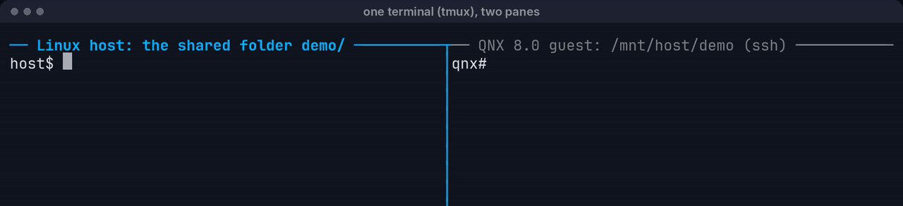
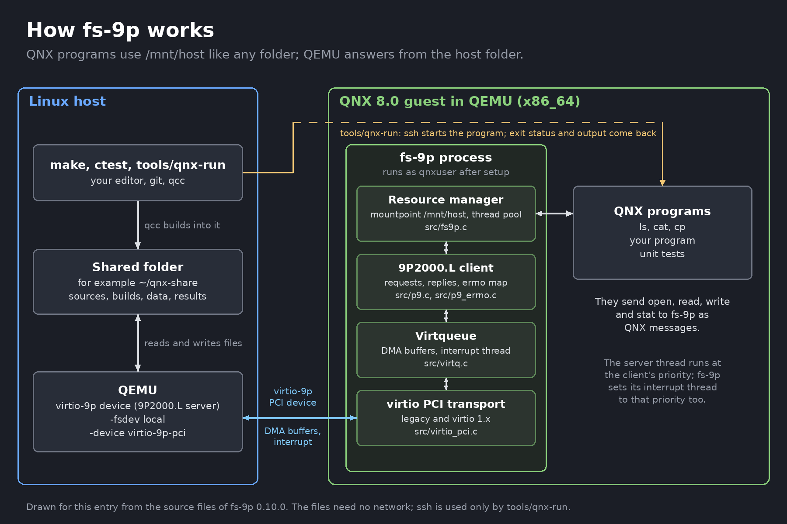

# fs-9p: run host builds and tests in a QNX 8.0 guest

fs-9p is a QNX 8.0 file-system driver that shows a host folder at `/mnt/host` in a QEMU guest.
Set `CMAKE_CROSSCOMPILING_EMULATOR` to `tools/qnx-run`, and ctest, make and git bisect on a Linux
host run each test program on the QNX kernel; the guest writes coverage counters and core files
into the host build folder. No copy step, and no hosted CI, which the SDP licence rules out.

Video (2 min 37 s): https://youtu.be/AuPv2jGAMnA



*Build on the host (left), run in the guest (right): a real terminal recording ([how it was made](docs/video_script.md#readme-picture)).*

| cJSON's 22 tests in the QNX guest | scp | fs-9p |
|---|---|---|
| Runner script to write and keep | 108 lines, 77 of them code | none: `tools/qnx-run` |
| Files copied into the guest per run | 76 | 0 |
| Coverage files (`.gcda`) copied back | 68 | 0 |

*cJSON v1.7.18's own tests through ctest; both routes passed 22 of 22 ([scp log](tests/logs/scp_baseline_20261113_030937.log), [fs-9p log](tests/logs/cjson_20261113_030926.log), [scp runner](demo/scp-run.sh)).*

## Quick start

Needs a Linux host with QEMU and KVM, QNX SDP 8.0 (free non-commercial licence) and an ssh key.
A running Quick Start Target Image can get fs-9p instead ([four steps](docs/usage.md#qnx-80-quick-start-target-image)).
For a new image, set three variables and the SDP environment, then run the three commands in this repository's folder:

```sh
source ~/qnx800/qnxsdp-env.sh      # path of your SDP 8.0 installation
IMAGE=~/fs9p-image                 # folder for the QNX 8.0 image
SHARE=~/qnx-share                  # host folder that the guest sees at /mnt/host
SSH_PORT=2222                      # host port forwarded to the guest's ssh port
```

<!-- readme-run:quickstart -->
```sh
make                                              # 1. build fs-9p with qcc
tools/make-image.sh "$IMAGE"                      # 2. once: QNX 8.0 image that starts fs-9p at boot
tools/qnx-vm start "$IMAGE" "$SHARE" "$SSH_PORT"  # 3. boot it in the background with the shared folder
```

Step 2 puts your public key (`~/.ssh/id_*.pub`) into the image for ssh logins as root. Step 3
returns when fs-9p has mounted the share. Then any host terminal builds into the share and runs in QNX:

<!-- readme-run:use -->
```sh
export QNX_IMAGE="$IMAGE"                         # tools/qnx-run finds the VM's share and port here
printf '#include <stdio.h>\nint main(void) { puts("hello from QNX"); return 0; }\n' > "$SHARE/hello.c"
qcc -Vgcc_ntox86_64 -o "$SHARE/hello" "$SHARE/hello.c"
tools/qnx-run "$SHARE/hello"                      # runs /mnt/host/hello in the guest; output, exit status here
make -C examples/qnx-unit B="$SHARE/qnx-unit-build" qnx-test   # QNX unit tests in the guest, JUnit files
```

`tools/qnx-vm status`, `console` and `stop` manage the VM. More workflows: [docs/usage.md](docs/usage.md).

## What you get

Code that uses QNX message passing or priority inheritance must be tested on the QNX kernel. Each
workflow below ran in this repository's tests or demos ([log of each number](docs/evidence.md)).

| Workflow | What you see |
|---|---|
| Tests from `make`, `ctest` and `git bisect` | `tools/qnx-run` runs each test in the guest and returns its exit status and output; `-t SECONDS`, ctest's `TIMEOUT` or Ctrl-C stops the test in the guest. cJSON v1.7.18: 22 of 22 test programs passed, with 3 of its `add_test` lines changed so that CMake applies the variable ([cJSON run](docs/real-project.md)) |
| Coverage and core files on the host | the guest writes the `.gcda` files into the host build folder (gcovr: 88 % of the lines and 76 % of the branches of `cJSON.c`) and a crashed program's core file into the share, where the SDP's `ntox86_64-gdb` reads it |
| A team's test machine | `tools/qnx-ci.sh "$IMAGE" "$SHARE" PROJECT...` boots the guest, runs each project's ctest suite in it, writes JUnit files (with gdb's backtrace for a crashed test) and gcovr reports, and stops the guest |
| Coding agents | `tools/qnx-run --json` prints one JSON line per run; [AGENTS.md](AGENTS.md) lists the commands; a [recorded session](examples/ai-agent-session-libxml2/) shows a fresh agent fixing the libxml2 bug below |
| Host-only tests, no SDP | `make host-check`: table tests and a fuzz run of the 9P codec with host gcc; `.github/workflows/host-tests.yml` runs the same command on GitHub Actions ([first run, 2026-11-21: passed](https://github.com/SeongRaeNoh/fs-9p/actions/runs/44883385393)) |

Projects under ISO 26262 or IEC 62304 collect structural coverage as test evidence; with fs-9p it comes
from test runs on the QNX kernel. fs-9p is a development and test tool, not a qualified tool, and claims no conformance with either standard.

## Found by tests in the guest

The QNX guest exposed a latent libxml2 bug that the glibc run did not show. In libxml2 v2.15.4,
`xmlNewTextReaderFilename(NULL)` passes a null pointer to a `%s` format, which is undefined
behaviour in libxml2's code, and libxml2's own test program `testapi` crashed in the guest. gdb's
backtrace from its core file (`xmlreader.c:2104`) is in the test's JUnit entry. A fresh AI agent fixed
the bug with this repository's tools, tests unchanged: then 8 of 8 test programs passed in the guest
([recorded session](examples/ai-agent-session-libxml2/)).
No public report was found on 2026-11-13 ([the search](docs/upstream-search.md)).

## Open-source libraries: their own tests in the guest

`demo/oss-suite.sh` builds seven open-source C libraries with qcc at their release tags, sources
unchanged, and runs the own ctest suite of six of them in the guest (libuv is built only): 37 of 39
ctest tests passed; the 2 failures are crashes of libxml2's `testapi` ([details](docs/oss-suite.md)).

| Library | Build with qcc | Own tests in the QNX guest |
|---|---|---|
| zlib v1.3.1, libyaml 0.2.5, libdeflate v1.24, utf8proc v2.10.0 | no QNX-only build option | 21 of 21 (2, 2, 8, 9) |
| check 0.15.2 | two QNX-only build options; its timing-dependent self-tests are disabled in this suite, on both platforms | 2 of 2 test programs; its 7 shell-script tests are left out |
| libxml2 v2.13.5 | one QNX-only build option (modules off) | 7 of 8; `testapi` crashed: a known libxml2 bug, fixed upstream in v2.13.6 |
| libxml2 v2.15.4 | no QNX-only build option | 7 of 8 (14 script and catalog tests left out); `testapi` crashed: the bug [above](#found-by-tests-in-the-guest) |
| libuv v1.53.0 | one QNX-only build option (`-lm` for its test programs) | built only; its test suite was not run in this suite |

## How it works



fs-9p is a resource manager, an ordinary QNX process that starts at boot and runs as a normal user.
Its interrupt thread runs at the highest waiting client's priority, and each request slot is a
priority-inheritance mutex: in the tested cases, a client in the guest was not delayed by lower-priority work ([results](docs/evidence.md#priority-through-the-driver), [QNX technologies and their tests](docs/evidence.md#qnx-technologies-and-the-tests-that-check-them), [internals](docs/internals.md)).

## Limitations of 0.10.0

- Hard links return `ENOSYS`; open files do not survive a driver restart; no Tflush; QEMU's 9P server on the host does not follow QNX priorities.
- x86_64 with PCI only, tested with KVM only; fs-9p also compiles for aarch64le ([build](evidence/aarch64_build.txt)), untested there. Full list: [docs/usage.md](docs/usage.md#limitations-of-0100).

## Requirements

- QNX SDP 8.0 with the x86_64 target: `qcc` (tested: `qcc -Vgcc_ntox86_64`, GCC 12.2.0), `mkqnximage`.
- A Linux host with QEMU and KVM (tested: QEMU 6.2.0 on Ubuntu 22.04).
- For `tools/qnx-ci.sh` and the CMake example: CMake 3.21 or newer (tested: 3.31.6); gcovr for coverage.

This repository contains no QNX SDP files (headers, libraries, binaries or images). Documentation:
[usage](docs/usage.md), [evidence](docs/evidence.md), [internals](docs/internals.md), [tests and logs](docs/testing.md), [open-source suites](docs/oss-suite.md), [cJSON run](docs/real-project.md).

## How this was built

An AI coding agent (Claude Code, by Anthropic) wrote and tested the code, the tests and this README.
I solved the problems in a question-and-answer dialogue with the coding agent.

## Licence

Apache License 2.0 (see `LICENSE`).
