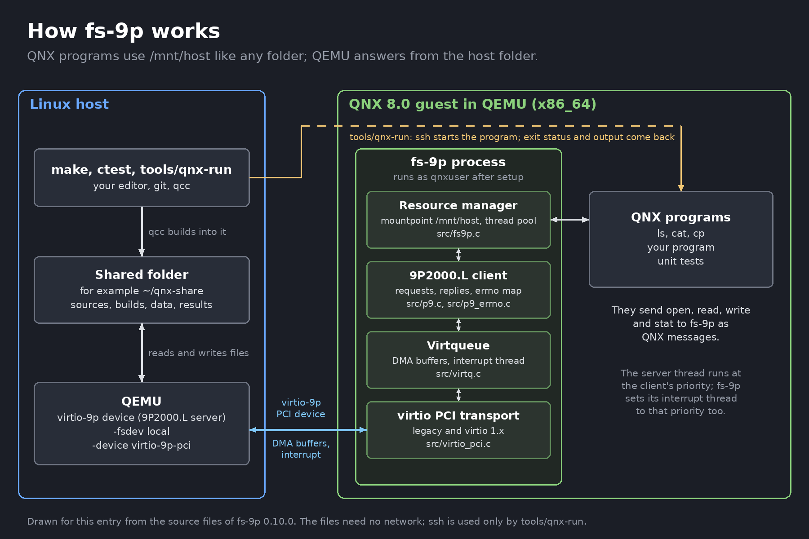
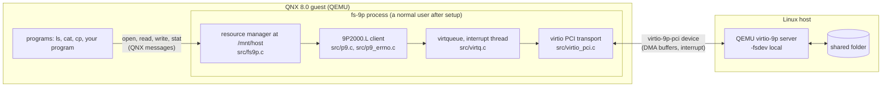

# fs-9p internals

How fs-9p 0.10.0 works, which QNX interfaces it uses, how `tools/qnx-run` stops a guest program, what
fs-9p supports, and the problems that the tests found. Back to the [README](../README.md).

## Architecture

A client's `open()` arrives as a QNX connect message at the resource manager. fs-9p walks a 9P fid
to the path and keeps it in the open control block (OCB). Reads, writes and attribute changes on
that file descriptor become 9P requests on that fid. Each request occupies one virtqueue slot, and
the slot number is the 9P tag, so several clients are served at the same time. QEMU answers from
the host folder.

| Layer | File | QNX interfaces used |
|---|---|---|
| PCI transport: find the device, map its BARs, legacy (I/O port) or virtio 1.x (memory BAR, capability list) register access | `src/virtio_pci.c` | `pci_device_*`, `mmap_device_io`, `mmap_device_memory`, `in8`/`out16`..., `ThreadCtl(_NTO_TCTL_IO_LEVEL)` |
| Virtqueue: one split ring with 16 request slots (`-n`, at most 64), physically contiguous DMA buffers, one priority-inheritance mutex per request slot, an interrupt thread (base priority 21, `-i`; set to the highest waiting client's priority, also below the base) | `src/virtq.c` | `mmap(MAP_PHYS \| MAP_ANON)`, `mem_offset64`, `InterruptAttachEvent` (`SIGEV_INTR`), `InterruptWait`, `InterruptUnmask`, `pthread_attr_setschedparam`, `pthread_setschedprio`, `pthread_mutexattr_setprotocol` (`PTHREAD_PRIO_INHERIT`) |
| 9P2000.L messages: version, attach, walk, getattr, setattr, lopen, read, readdir, clunk, lcreate, write, mkdir, unlinkat, renameat, fsync, readlink, symlink, statfs | `src/p9.c` | none (portable C) |
| Linux errno values in `Rlerror` mapped to QNX errno values (117-row table) | `src/p9_errno.c` | QNX `<errno.h>` names |
| Resource manager: mountpoint, open, read, write, readdir, stat, close, mkdir, unlink, rename, chmod, chown, utime, ftruncate, fsync, symlink, readlink, link redirects, `statvfs` (devctl); thread pool; privilege drop (`-U`) | `src/fs9p.c` | `resmgr_attach`, `iofunc_*`, `dispatch_*`, `thread_pool_*`, `MsgReply`, `_IO_SET_CONNECT_RET`, `procmgr_ability`, `setuid` |

`tools/v9p_probe.c` is a diagnostic tool that runs the protocol steps one by one and prints every
message. `tests/errno_test.c` tests the errno table; `tests/attr_test.c` and `tests/link_test.c`
are the guest programs of the attribute test and the link test.

### Symbolic links and `statvfs`

QNX resolves a path in the client library: a resource manager that meets a symbolic link answers
the open (connect) message with a redirect, and the client sends the open again for the new path.
fs-9p does that:

- **Following a link.** When the 9P walk reaches a link, fs-9p reads it with `Treadlink`, builds an
  absolute path (a relative target is joined to the mountpoint and the link's folder), and replies
  with `_IO_CONNECT_RET_LINK` and a `struct _io_connect_link_reply` followed by that path. Links to
  other file systems (`abs_null -> /dev/null` in the test) and loops are therefore handled by the
  client library, which ends a loop with `ELOOP`. A link as the last name is followed unless the
  connect message carries the mode `S_IFLNK`, which `lstat()` sends (`fs_open()` in `src/fs9p.c`).
- **QEMU 6.2 and links inside a path.** QEMU's 9P server answers a walk through a link that is not
  the last name with `ENOTDIR` for the whole walk, not with a partial reply; fs-9p then walks one
  name at a time to find the link (`walk_names()` and `find_link()` in `src/fs9p.c`).
- **readlink and symlink.** `readlink()` arrives as a connect message of subtype
  `_IO_CONNECT_READLINK`; fs-9p answers with the same reply layout without the redirect status
  (`fs_readlink()`). `symlink()` arrives as `_IO_CONNECT_LINK` with `_IO_CONNECT_EXTRA_SYMLINK` and
  becomes `Tsymlink` (`fs_link()`).
  Hard links (other `_IO_CONNECT_LINK` types) return `ENOSYS`. A rename whose old path lies below a
  linked folder returns `EXDEV`, so `mv` copies and removes.
- **statvfs.** `statvfs()` and `fstatvfs()` reach fs-9p as devctl `DCMD_FSYS_STATVFS`; fs-9p sends
  `Tstatfs` and fills the reply from QEMU's answer (`fs_devctl()` in `src/fs9p.c`).

The guest test checks these cases (step "symbolic links", 8 checks) and loads a versioned shared
library (`libx.so -> libx.so.1 -> libx.so.1.0`) from the share (step "a versioned shared library",
2 checks); `evidence/symlinks_statvfs.txt` is the excerpt.

## How fs-9p uses QNX interfaces

fs-9p finds and attaches the PCI device through the PCI server API (`libpci`: `pci_device_find`,
`pci_device_attach`, `pci_device_read_ba`, `pci_device_read_irq`, `pci_device_map_as`), maps the
device registers (`mmap_device_io`, `mmap_device_memory`), gives the device physically contiguous
DMA buffers (`mmap` with `MAP_PHYS`, `mem_offset64`), and takes the device interrupt in its own
thread (`InterruptAttachEvent`, `InterruptWait`, `InterruptUnmask`). It presents the device to
programs as a file system through the resource manager framework (`resmgr_attach`, `iofunc_*`,
`dispatch_*`, thread pool), and drops privileges with `procmgr_ability()` and `setuid()`. It does
not use a framework of the QNX Driver Development Kit (DDK): the
[DDK guide](https://www.qnx.com/developers/docs/qnxeverywhere/com.qnx.doc.ddk/topic/about.html)
lists frameworks for other device classes (character I/O and UART, I2C, SPI, HID, touch, network,
CAN). fs-9p is built with `qcc` from QNX SDP 8.0 and links only the C library and `libpci`.

## QNX features that fs-9p uses

On QNX a file system is an ordinary process (a resource manager), not code inside the kernel. fs-9p
uses that model in four ways, each shown in a test log:

1. **Started from the image's start-up script.** `tools/make-image.sh` adds fs-9p to the image with
   `mkqnximage` snippet files; the guest boots with `/mnt/host` mounted
   (`tests/logs/readme_run_20261113_031028.log`).
2. **Runs as a normal user with two abilities.** With `-U user`, fs-9p does its privileged setup as
   root (PCI attach, register and DMA mappings, interrupt attach, mountpoint), then calls
   `procmgr_ability()` so that the non-root set allows only `io` (I/O privilege for thread-pool
   threads that start later) and `priority` (clients above the maximum priority for unprivileged
   processes, usually 63, are served at their own priority; see item 3), denies every other
   ability, locks all of them, and calls `setuid()`. This is the method that the QNX 8.0 System
   Security Guide describes on its page
   [Process manager abilities](https://www.qnx.com/developers/docs/8.0/com.qnx.doc.security.system/topic/manual/process_manager_abilities.html).
   `pidin` in the test logs shows the user ID 1000 and the two locked abilities.
3. **The interrupt thread and the request slots follow the priority of the waiting client.** QNX message passing runs
   the server thread at the client's priority (System Architecture guide, "Priority inheritance and
   messages"). That thread then waits for fs-9p's interrupt thread, which receives no message and
   so inherits nothing. Before a request goes to the device, and again after its reply, fs-9p sets
   the interrupt thread with `pthread_setschedprio()` to the highest priority among the threads with
   a request in flight (read from `sched_curpriority`, which includes the inherited priority), also
   below its base priority (`-i`, default 21). With no request in flight, a thread above the base
   returns to the base, and a thread below the base stays until the next request (so clients at
   priority 10 do not cost two priority changes per request). `-f` keeps the fixed base priority of
   0.5.0. The test puts eight CPU-bound loops at priority 30 next to a reader at priority 40: with
   `-f` the waiting thread had to collect completions itself through its fallback wait (24 of 27
   requests in each of 5 runs of `demo/priority.sh`, `tests/logs/priority_20261113_024628.log`
   line 488; 24 in the cited guest test, `tests/logs/guest_tests_20261113_025442.log`
   line 610, and 8 in each of the other two guest-test runs on the same sources; [counts by run](testing.md#fallback-counts-by-run)); by default the interrupt thread
   was set to 40 and every completion came through it (0 in every run). (Fallback wait:
   a server thread that waits for the device looks at the used ring itself every 200 ms,
   `vq_submit_wait()` in `src/virtq.c`; the 200 ms is a constant, not a measurement.) A reader at
   priority 8 gets an interrupt thread at 8 by default and at 21 with `-f`. A second
   test runs fs-9p as `qnxuser` and a reader at priority 70 next to loops at 65: with the kept
   `priority` ability the pool thread runs at 70 and the interrupt thread is raised to 70 (0 failed
   priority changes); with `-P` (ability left out) the pool thread runs at 63, below the loops, and
   the read finished only after loops had ended (8 of 8 in the 0.10.0 guest test,
   `tests/logs/guest_tests_20261113_025442.log` line 645; the guest has 4 processors, and the check
   requires more than 8 minus 4).

   A client can also wait for a request slot: when every slot is taken, its server thread waits
   until one is given back. Since 0.10.0 each slot has a mutex with the protocol
   `PTHREAD_PRIO_INHERIT`, which the slot's owner holds from `vq_get()` to `vq_put()`. A server
   thread that finds no free slot blocks on the mutex of an owned slot, so the kernel runs that
   slot's owner at the waiter's priority until the owner unlocks the mutex; `vq_put()` then hands
   the slot to the highest-priority thread blocked on it, and a waiting thread also counts for the
   interrupt thread's priority (`src/virtq.c`, `src/virtq.h`). `-w` turns off only this slot part
   (the behaviour of 0.9.0); `-f` turns off both parts. The test runs `fs-9p -n 1` (one slot) on a
   device whose reads QEMU throttles, with a reader at priority 10 that holds the slot. Without
   load, a thread of fs-9p waited on the slot's mutex during 3 of 3 reads at 40, and `pidin` showed
   the waiting thread and the slot's owner at 40 (`40r`/`40r`); with `-w`, 0 of 3
   (`tests/logs/guest_tests_20261113_025442.log` line 711; `tests/logs/priority_20261113_024628.log`
   line 489). With 8 loops at priority 30, the read at 40 ended while all 8 loops ran (0 of 8 had
   ended) by default, and only after 8 of 8 had ended with `-w` and with `-f`, in the guest test
   (line 712) and in each of 5 runs of `demo/priority.sh` (line 490); by default 1 slot was handed
   over in each run, and the md5 of the read was equal to the host's in all 15 runs (line 491).
   The priorities end at the device: QEMU's 9P server on the Linux host serves the requests in its
   own order, not by QNX priority ([usage](usage.md), "Limitations"). Counters are in
   `evidence/priority_following.txt`; the test prints no measured times.
4. **A crashed driver is a process that is started again.** The test kills fs-9p with `slay -9`
   while a shell holds a file on `/mnt/host` open. `ls /mnt/host` then fails with exit status 1 (the
   mountpoint is gone), and the shell goes on with its next command. A new `fs-9p -d` mounts again
   (exit status 0). A read on the descriptor that was opened before the kill fails with status 1;
   bash reports "Bad file descriptor" and, when it duplicates the descriptor, "cannot duplicate fd:
   No such process". A new open of the same file reads it correctly. No reboot is needed. Since
   0.7.0 the boot script starts fs-9p under `image/fs-9p-supervise`, a shell loop that starts it
   again when a signal ends it (at most `FS9P_RESTART_MAX`=5 restarts within
   `FS9P_RESTART_WINDOW`=60 s), so the share comes back without a typed command. The supervisor is a
   separate shell process: `slay -9 fs-9p` matches the driver's name, and a supervisor inside fs-9p
   would carry the same name and be killed with it.

## Features

| Operation in the guest | 9P2000.L messages | Checked by |
|---|---|---|
| open, read, pread, lseek, close | Twalk, Tgetattr, Tlopen, Tread, Tclunk | `tests/host_side.sh` (checksums of 191 files, 12 MiB and 100 MiB files) |
| readdir (`ls`, `find`) | Treaddir | same; folders with 150 and 2,000 entries |
| stat, fstat | Tgetattr | same |
| write, pwrite, append, `O_TRUNC` | Twrite, Tlopen | same; 100 MiB in one `write()` |
| create (`O_CREAT`, `O_EXCL`) | Tlcreate | same; 2,000 files |
| mkdir, rmdir, unlink, rename | Tmkdir, Tunlinkat, Trenameat | same; path of depth 20 |
| chmod, fchmod | Tsetattr (mode) | `tests/attr_test.c` |
| chown | Tsetattr (uid, gid); the host decides what is allowed | same |
| utime, utimes (seconds and nanoseconds), `utime(NULL)` | Tsetattr (atime, mtime) | same |
| ftruncate, truncate (shrink and grow) | Tsetattr (size) | same |
| fsync | Tfsync | same |
| start a program from the share | as open and read | `tests/host_side.sh`, `tests/readme_run.sh`, `demo/workflow.sh` |
| symbolic links: `lstat`, `stat`, `open` through links, `readlink`, `symlink`, `unlink` | Twalk, Treadlink, Tsymlink, Tunlinkat; redirect of the open | `tests/link_test.c` (chains, folder links, `..`, dangling link, loop, absolute target) |
| a program that loads a versioned shared library from the share | as above | `tests/host_side.sh`, step "a versioned shared library"; `demo/cjson.sh` (`libcjson.so.1`) |
| `statvfs`, `fstatvfs` (`df`) | Tstatfs | `tests/link_test.c`, compared with the host's `statfs` |
| a core file written by the guest's `dumper` | as create and write | `tests/host_side.sh`, step "core dumps through the share" |
| several clients at the same time | one request per virtqueue slot in flight; 16 slots, `-n` up to 64 | two readers and a `find`; two writers; 64 readers with `-n 64` |
| read-only mount (`-r`) | none (the guest side answers `EROFS`) | `tests/host_side.sh` |

Device side, each checked in the main test log: the legacy PCI interface (transitional device
1af4:1009) and the virtio 1.x interface (`-t modern` on the transitional device; `-t auto` on a
modern-only device 1af4:1049, with the write and attribute tests); interrupt-driven completion, or
polling with `-p`; two devices at the same time, each selected by its mount tag with `-a` and
served by its own fs-9p instance.

## How `tools/qnx-run` stops a guest program

`tools/qnx-run` sends one shell command over ssh. The guest shell starts the program as a
background job in its own process group (`set -m`) and starts one or two watcher subshells:

- Watcher A (without `-i`) reads the ssh channel's stdin. The host writes the line `stop` into it
  when `qnx-run` gets SIGINT, SIGTERM or SIGHUP. End of input without `stop` means that the host
  side is gone; the watcher then checks once a second whether the guest's ssh session process (the
  shell's parent) still exists.
- Watcher B (with `-t`, and always with `-i`) counts seconds up to the `-t` limit and, with `-i`,
  checks the ssh session once a second.

A watcher stops the program with SIGTERM to its process group and SIGKILL 2 s later (a constant in
`tools/qnx-run`). The guest shell waits for the program and exits with its status, or with 124
when watcher B stopped it at the limit.

On the host, ssh runs in the background with SIGINT, SIGQUIT, SIGTERM and SIGHUP ignored (OpenSSH
keeps a signal ignored that was ignored at its start), so a Ctrl-C reaches only `qnx-run`. The
stdin of ssh is a FIFO that `qnx-run` holds open; on a signal, `qnx-run` writes `stop` into it,
waits for ssh to end and returns 128+N. If the guest does not answer, `qnx-run` kills ssh 15 s
after the signal, or 30 s after the `-t` limit (constants).

The guest, not the host, stops the program, because ctest's `TIMEOUT` ends the test command in a
way that a shell trap cannot catch: in a probe with ctest 3.31.6 during 0.9.0 development, traps on
SIGTERM and SIGINT in the test command never ran. A second probe showed that after the host's ssh
client is killed, OpenSSH's session process in the guest ends, but a guest command without a
terminal keeps running. The output of both probes is not part of this repository. The guest test
checks the result (0 processes left) after the `-t` limit, SIGINT, SIGTERM and ctest `TIMEOUT 5`
(step "tools/qnx-run stops the guest program", 6 checks, `tests/logs/guest_tests_20261113_025442.log`
lines 451-488; one of the checks starts the program as `qnxuser` with `-u`).

For `--json`, the guest shell writes one marker line to stderr with the number and the guest's
name (`kill -l`) of the signal that ended the program; `qnx-run` removes that line from the
program's stderr and puts the values into `signal` and `signal_name`.

## Problems found and how they were solved

The file checks of the guest test compare each result in the guest with the host folder. The tests
and the reviews found these problems.

| Problem | How it showed | Cause | Fix |
|---|---|---|---|
| Lost interrupt | With a modern-only device (PCI ID 1af4:1049) many requests were completed by the waiter's fallback wait (its own check of the ring every 200 ms) instead of the interrupt thread (counter "reaped by waiters", test step "two virtio-9p devices", before version 0.4.0; the log of that run was not kept). | The interrupt thread did not read the device's ISR register again after `InterruptUnmask()`, so a completion that arrived while the interrupt was masked waited for the fallback wait (inferred from the counters). | After `InterruptUnmask()` the interrupt thread reads the device's ISR register once more and collects completions if its bit is set (`src/virtq.c`). Since 0.4.0 the runs show 0 completions from the fallback scan. |
| A program on the share could not be started | Starting a program from `/mnt/host` failed (version 0.2.0, test step "run a program from the share"; the log of that run was not kept). | To start a program, the resource manager library makes a second open control block (OCB) for the already open file. fs-9p gives each OCB its own 9P fid, and that second OCB had none, so QEMU answered `ENOENT`. Found with fs-9p's 9P message trace (`-vvv`). | The library's second OCB gets a clone of the open file's fid (`ocb_calloc()` in `src/fs9p.c`, version 0.3.0). |
| Interrupt thread below the client | With a fixed interrupt-thread priority (0.5.0, now `-f`) below the client's, CPU load between the two priorities delayed most completions until the fallback wait (step "interrupt-thread priority under CPU load": 24 in the cited run of the guest test, `tests/logs/guest_tests_20261113_025442.log` line 610 (the count with `-f` differs between runs: 8 in each of the other two runs); 24 of 27 in each of 5 runs of `demo/priority.sh`, `tests/logs/priority_20261113_024628.log` line 488; older runs in [counts by run](testing.md#fallback-counts-by-run)). | The interrupt thread receives no message, so message passing does not lend it the client's priority. | Version 0.6.0 raises the interrupt thread to the highest waiting client's priority, and 0.7.0 also sets it below the base for lower clients (`src/virtq.c`); 0 fallback-wait completions in the same tests. |
| `O_EXCL` create | The generic open check would refuse a file that fs-9p has just created. | After fs-9p creates the file on the host (`Tlcreate`), the node exists, so `iofunc_open()` reports `EEXIST` for `O_CREAT \| O_EXCL`. | The create path attaches the OCB with `iofunc_ocb_attach()` only and leaves the permission check to the host (`fs_open()` in `src/fs9p.c`); 2,000 creates pass in the robustness test. |
| A crash looked like a lost connection | The first run of the core-dump step (0.8.0 development; that run's log was not kept) gave `tools/qnx-run` the exit status 255, the code for "ssh cannot reach the guest", for a program that a signal had ended. | The guest shell started the program with `exec`, so the shell ended with the program and ssh reported the lost session as 255. | Since 0.8.0 the guest shell waits for the program instead of replacing itself with it and reports 128+N. The 0.10.0 guest test checks exit status 139 for a segmentation fault (`tests/logs/guest_tests_20261113_025442.log` line 174). |
| A walk through a folder link failed | QEMU 6.2 answered a 9P walk through a link that is not the last name with `ENOTDIR` for the whole walk (found during 0.8.0 development). | QEMU's 9P server does not follow links and gives no partial reply in that case. | fs-9p walks one name at a time after `ENOTDIR` or `ELOOP` to find the link, then redirects (`find_link()` in `src/fs9p.c`); the link test reads through a folder link inside a path. |
| A program that ctest stopped kept running in the guest | Found while 0.9.0 was designed: after a time-out, nothing on the host could stop the guest program (probes described in "How `tools/qnx-run` stops a guest program"). | ctest's `TIMEOUT` ends the test command without a signal that a trap can catch, and a guest command without a terminal outlives its ssh session. | Since 0.9.0 the guest watches its ssh session and stops the program's process group (section above); the guest test's ctest `TIMEOUT 5` check finds 0 processes left (`tests/logs/guest_tests_20261113_025442.log` line 488). |
| A guest function named `stop` did not parse | A test run during 0.9.0 development: the README run failed 12 of 17 checks with "sh: syntax error: `(' unexpected" (the log of that run was not kept). | The image that the README quick start builds gives root `/bin/sh` (PD KSH v5.2.14) as its login shell, and that shell defines `stop` as an alias of `kill -STOP`. The images of the guest test and of the Quick Start test give bash. | The function is named `qr_stop`; the 0.10.0 README run passes 17 of 17 (`tests/logs/readme_run_20261113_031028.log` line 155). |
| A client waiting for a request slot got no priority help | Found by review of 0.9.0, not by a failed test. 0.10.0 reproduces the 0.9.0 behaviour with `-w`: with one slot (`-n 1`) held by a reader at 10 and 8 loops at 30, a read at 40 ended only after 8 of 8 loops had ended, in each of 5 runs of `demo/priority.sh` (`tests/logs/priority_20261113_024628.log` line 490). | A server thread that found every slot taken waited on a condition variable, which lends no priority to the slot's owner; the interrupt thread followed only threads with a request in flight, so it stayed at the owner's priority too (`pidin` with `-w`: waiting thread `40r CONDVAR`, interrupt thread `10f`, same log lines 246-248). | Since 0.10.0 each slot has a `PTHREAD_PRIO_INHERIT` mutex; a waiting thread blocks on it, the kernel runs the slot's owner at the waiter's priority, and `vq_put()` hands the slot to the highest-priority waiter (`src/virtq.c`). With the same setup the read at 40 ended while all 8 loops ran (0 of 8 ended) by default in each of 5 runs (line 490), after 8 of 8 had ended with `-w`; the guest test gives 0 of 8 by default and 8 of 8 with `-w` (`tests/logs/guest_tests_20261113_025442.log` line 712). |
